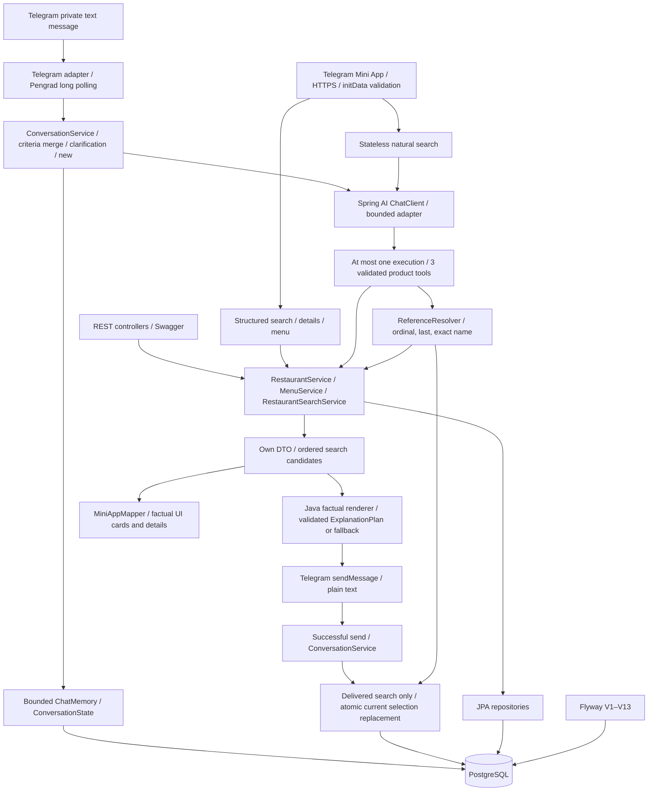

# Архитектура

Один Spring Boot application, один Maven module, modular monolith и одна PostgreSQL.
Продуктовый scope: [PRODUCT](PRODUCT.md). AI contracts: [AI](AI.md).
Схема и provenance: [DATABASE](DATABASE.md). Runtime: [DEPLOYMENT](DEPLOYMENT.md).

Telegram Bot и Mini App используют общий Java search; HTTPS/private boundary:
[DEPLOYMENT](DEPLOYMENT.md#deployment-topology--implemented).

## Реализованная архитектура — IMPLEMENTED

## Компоненты и границы

| Пакет / компоненты | Ответственность |
|---|---|
| `catalog`: RestaurantService, MenuService, MenuImportService | Каталог, собственные details/меню, persistence и controlled import |
| `search`: RestaurantSearchService | Criteria validation, hard filters, estimated total, ranking и Clock |
| `api`: REST controllers | DTO, HTTP mapping, Swagger |
| `ai`: SpringAiSearchAdapter, tools, Java renderers | Интерпретация, три read-only tools, validated explanation/fallback и фактический ответ |
| `conversation`: ConversationService, ConversationStore | Merge criteria, clarification, bounded memory/state, команды и delivery callback |
| `conversation`: SelectionService, SelectionItemRepository | Атомарная замена показанных ID/positions и version |
| `conversation`: ReferenceResolver | Ordinal/last/exact name → restaurantId в текущем чате |
| `telegram`: TelegramUpdateHandler, polling, messages | Private text filtering, один poller, plain-text split и результат доставки |
| `miniapp`: controller, mapper, static UI | Signed API, structured/stateless natural search и UI projections |

Adapters → application services → repositories/clients. Services поиска/меню/details
не зависят от Telegram, ConversationService или Spring AI SDK. Telegram handler
вызывает ConversationService без HTTP к собственному приложению, доступа к repository,
дополнительных model calls или retries. Structured Mini App вызывает services напрямую;
natural search использует stateless AI adapter.

Controllers не выполняют поиск и не возвращают JPA entities. Own DTO создаются внутри
read-only transactions, `open-in-view=false`. Денежные значения — BigDecimal.
HTTP/LLM calls выполняются вне DB transactions. Модель не получает SQL/JPA-доступа;
tool contracts и передача данных модели: [AI](AI.md#общие-tool-contracts).

ReferenceResolver читает selection через SelectionService, имена — через RestaurantService,
без прямого RestaurantRepository/LLM/search. Telegram и AI adapters не получают selection
repository. Текущая подборка заменяется только после успешной отправки search;
REST и Mini App её не обновляют. Полный lifecycle criteria, memory, `/new`, references
и ошибок сохранения: [AI](AI.md#conversationstate-и-selection-context).

### Telegram turn serialization и delivery boundary

Существующие 64 bounded process-local lock stripes в ConversationService защищают
весь turn одного chatId: load → merge/model/service → send всех частей → memory/selection
commit, включая `/new`. Чаты разных stripes могут выполняться независимо; hash collision
может сериализовать разные чаты, не смешивая state. Это механизм одного процесса,
без distributed guarantees. Один Pengrad poller передаёт batch синхронно в порядке
library updates; следующий poll начинается после возврата listener. Runtime polling
поэтому может ждать медленный turn другого чата. Прямой concurrent entry проверен
на двух updates одного чата и отдельном чате.

`/start`, `/help`, unknown commands и input length rejection — Java-only, до DB/model.
`/new` использует прежний transactional reset. DB load/read/save/reset failures дают
controlled temporary response; ошибка сохранения после send сообщает о невозможности
сохранить разговор, без повторного model/tool call. Send callback exception/null/false
считаются failed delivery. Lossless split принадлежит Telegram adapter; все части должны
успешно отправиться до замены selection и записи transcript. Partial send сохраняет
старую selection/version; часть текста уже может быть видна пользователю.
Library acknowledgment и crash/restart boundary: [DEPLOYMENT](DEPLOYMENT.md#update--offset-behavior).

## Правила поиска и рекомендаций

### Criteria

Поиск относится к конкретному посещению. Обязательны guests, totalBudgetByn, date и time;
cuisine и preferredTags опциональны. Поддержаны Минск, BYN, 1–6 гостей, сегодня и
следующие шесть дней. Clock определяет текущую дату в Europe/Minsk независимо от ОС.
REST принимает уже структурированный запрос, не разбирает естественный язык.
Неоднозначность бюджета/времени и missing fields требуют уточнения;
Java сохраняет normalized currentCriteria и объединяет follow-up до search service.
Supplied invalid values отклоняются до merge; missing fields вычисляются заново.
Точные merge/ambiguity/memory contracts принадлежат [AI](AI.md).

### Hard filters

1. Ресторан существует в собственном фиксированном каталоге, active=true.
2. При заданной cuisine ресторан содержит эту кухню.
3. Есть собственный положительный estimatedCheckPerGuest с type/source/date;
   `estimatedCheckPerGuest × guests <= totalBudgetByn`.
4. Сохранённое расписание с source/date содержит requested date + local arrival time.

`guests` — входная валидация и множитель бюджета, не самостоятельный фильтр ресторана.
Данных capacity/maxPartySize/reservation limits нет; наличие столика не проверяется.
Неизвестный check или неизвестные hours не подтверждают соответствующее условие.
MenuItem rows и menu metadata не влияют на eligibility. Ограничения не ослабляются
при пустой выдаче или высоком soft score.

### Opening hours

Существующие opening_intervals задают weekday, opensAt, closesAt и closesNextDay.
Интервалы имеют границы `[open, close)`: открытие включено, закрытие исключено.
Учитываются текущий день и продолжение overnight interval предыдущего weekday.
Например, Friday 18:00 → Saturday 02:00 включает Friday 23:00 и Saturday 01:00,
но исключает Saturday 02:00 и 03:00. Поддержаны несколько интервалов и переход недели.
Интервал open==close запрещён; scheduling/calendar subsystem отсутствует.
Проверяется прибытие, не длительность ужина. Недельные часы не гарантируют праздничных.

### Soft criteria

Поддержаны RestaurantTag: COZY, QUIET, ROMANTIC, CASUAL, FRIENDS, PREMIUM.
После hard filtering вычисляются совпадения запрошенных тегов с curated tags каталога.
Несовпавший тег не исключает ресторан. Теги не гарантируют обстановку при посещении.

### Deterministic ranking

- MatchCount = число совпавших requested tags, по +1 за уникальный тег.
- Кухня уже hard filter, дополнительного балла за неё нет.
- Порядок: `matchCount DESC → estimatedTotalByn ASC → restaurant ID ASC`.
- После сортировки выбирается первый кандидат каждого `Restaurant.brandKey`;
  затем применяется limit: максимум 3 кандидата разных брендов.
- Если подходящих брендов меньше трёх, возвращается меньше результатов;
  hard filters ради заполнения выдачи не ослабляются.
- Одинаковые criteria и каталог дают одинаковый порядок.
- Google rating, случайность, LLM ranking, weights, embeddings, RAG и ML не используются.

Pipeline: catalog → hard filters → eligible restaurants → soft tag matching →
deterministic ranking → deduplication по явному brandKey → limit(3) → result.
Лучший подходящий филиал бренда определяется тем же ranking, без новых весов.
Принадлежность к бренду хранится в каталоге, не выводится из названий и не решается LLM:
[DATABASE](DATABASE.md#post-v2-01--brand-membership).
Чек используется как собственная оценка, не цена любого заказа.

### REST search contract

RestaurantSearchService читает небольшой каталог через RestaurantRepository и
выполняет фильтры/ranking в Java. SearchRequest содержит Integer guests, BigDecimal
общий бюджет, date (ISO date или контрактные TODAY/TOMORROW), time (HH:mm), optional
cuisine/preferredTags. TODAY/TOMORROW — фиксированные токены, не NLP parser.
Положительный бюджет допускает до двух знаков после запятой и нормализуется до scale=2
без округления. Дробный JSON guests не усекается, а отклоняется. Null/отсутствующий
preferredTags становится пустым enum set; дубли не увеличивают score.

SearchResult содержит normalizedCriteria, currency=BYN, ordered candidates и warnings.
Candidate: собственный RestaurantDetails DTO, estimatedTotalByn, matchCount,
allowedReasonCodes. Причины: CUISINE_MATCH при заданной кухне, BUDGET_MATCH,
HOURS_MATCH и `<TAG>_TAG_MATCH` только для совпавших запрошенных тегов.
AI explanation использует только допустимые причины: [AI](AI.md#гибридный-flow-и-объяснение).
Отдельных search tables, menu dependency и внешних API calls нет.
POST-V2-01 добавляет только brand membership в существующий каталог через V12.
Telegram и оба Mini App search используют это правило в общем RestaurantSearchService;
публичные DTO и tool contracts не расширяются.

## REST API

Четыре первоначальных endpoints реализованы. REST/Swagger — локальная проверка Java logic.
На host доступ ограничен loopback; public HTTPS proxy эти endpoints не публикует.
Сетевые требования: [DEPLOYMENT](DEPLOYMENT.md#доступ-и-секреты).

| Method / path | Вход / результат | HTTP |
|---|---|---|
| GET /api/v1/restaurants | page ≥0, size 1–100; active own catalog, id ASC | 200, 400 |
| GET /api/v1/restaurants/{id} | Own details по known ID | 200, 404 |
| GET /api/v1/restaurants/{id}/menu | Optional dishType/maxItemPriceByn; own partial menu | 200, 400, 404 |
| POST /api/v1/recommendations | Полные criteria, до 3 кандидатов и причины | 200, 400, 503 |

GET catalog пока не принимает cuisine filter. Details читает только собственные данные.
Search missing/invalid criteria → 400; отсутствие совпадений → 200 с пустым candidates;
DB/transaction failure → 503 без fallback facts. Entities/provider DTO наружу не выходят.
Menu status: AVAILABLE / NO_RESULTS / DATA_UNAVAILABLE. PARTIAL/source/date сохраняются
при пустом результате, если metadata есть; unknown restaurant → 404.
Menu filters и import semantics: [DATABASE](DATABASE.md#menu-data-strategy).

### V2-04 — Mini App boundary

В production работает отдельный adapter `miniapp`:
`/miniapp/` (static HTML/CSS/vanilla JS + официальный Telegram Web App SDK)
→ thin MiniAppController → RestaurantSearchService / RestaurantService / MenuService.
Контроллер не получает repositories/EntityManager. Services и search contract/ranking
не меняются. Structured search/details/menu работают без AI. External ingestion и conversation
memory/selection не участвуют ни в одном Mini App запросе.

| Method / path | UI response | HTTP |
|---|---|---|
| POST /api/miniapp/v1/search | guests, totalBudgetByn, date, time, optional cuisine → cards (≤3), warnings | 200, 400, 401, 503 |
| POST /api/miniapp/v1/search/natural | query (1–2000 characters) → status, cards (≤3), warnings, optional Java clarification message | 200, 400, 401, 503 |
| GET /api/miniapp/v1/restaurants/{id} | active known venue → details, weekly hours, secondary source links/dates | 200, 400, 401, 404, 503 |
| GET /api/miniapp/v1/restaurants/{id}/menu | available/notice/items (name, priceByn, optional portion) | 200, 400, 401, 404, 503 |

DTO являются UI projections, без JPA entities, seedKey, ranking scores, check type и
curator methodology. ID нужен только для follow-up requests, визуально не выводится.
Opening summary карточки сообщает подтверждённое existing search соответствие
времени прибытия; details показывает собственное недельное расписание с caveat.
Empty search → 200 с пустыми cards; UI показывает NO_RESULTS.

V2-05 natural search: тот же initData interceptor → existing SpringAiSearchAdapter
→ searchRestaurants → RestaurantSearchService → trusted SearchResult → MiniAppMapper.
Один полный self-contained query; history пустая, criteria preparation identity,
без ConversationState/ChatMemory/SelectionItem. Переиспользован existing Java
CriteriaAmbiguity.fields guard: «вечером» и неясная валюта требуют уточнения,
даже если модель подставила полные criteria. Доступность utility для adapter не
подключает разговорное состояние. Новых prompt/ChatClient/model/tools нет;
bounded execution и AI contract принадлежат [AI](AI.md#bounded-execution).

OK/NO_RESULTS возвращают только existing UI card projections из trusted result;
NEED_CLARIFICATION — пустые cards и Java-owned message. Conversational menu/details
tool без chat scope также получает clarification полного запроса. INVALID_INPUT →
400, TEMPORARILY_UNAVAILABLE → 503 TEMPORARY_ERROR; raw model prose/protocol,
adapter text и counters в API не выдаются. Disabled AI не создаёт обязательной
зависимости для structured search/details/menu. Подтверждённые tag reason codes
маппятся Java в подписи с оговоркой «по тегу каталога», без обещаний обстановки.
Ошибки имеют только `code`/безопасное `message`: INVALID_INPUT (400), AUTH_FAILED (401),
NOT_FOUND (404), TEMPORARY_ERROR (503), без exception/provider/SQL details.

Каждый `/api/miniapp/**` request проверяется MVC interceptor через raw header
`X-Telegram-Init-Data`. Изолированный TelegramMiniAppInitDataVerifier реализует
[официальный bot-token HMAC-SHA-256 алгоритм](https://core.telegram.org/bots/webapps#validating-data-received-via-the-mini-app):
URL-decode один раз, reject duplicates/malformed/control characters/oversized input,
все поля кроме hash сортируются и соединяются LF, HMAC key выводится из server-side
bot token с ключом WebAppData, hash сравнивается constant-time.
Поле signature, когда есть, остаётся частью bot-token HMAC (это не third-party Ed25519 flow).
Подписанный auth_date принимается не старше 3600 секунд, с допуском будущего 30 секунд.
Trusted context содержит только время аутентификации; userId/username из JS/query
не используются. Raw initData/token не сохраняются и не логируются. API responses no-store.
Это bounded launch proof; одноразовые session tokens/replay storage не добавлены.

Default `restaurant-bot.miniapp.dev-mode=false`: даже test profile требует подпись.
Явный dev mode требует dev/test profile, отсутствие prod/production и loopback server
binding; иначе startup fails. Только unsigned loopback requests разрешены в этом режиме;
предъявленная некорректная подпись всё равно отклоняется. Static assets публичны,
каталог API защищён. Действующий HTTPS route находится в Dokploy deployment Patch,
без публикации остальных REST/Swagger endpoints и PostgreSQL. Operational ограничения
и результаты live launch принадлежат
[DEPLOYMENT](DEPLOYMENT.md#v2-04--mini-app-local-demo-и-live-gate).

## Внешние интеграции

AI search — IMPLEMENTED: модель выбирает один searchRestaurants request и причины
объяснения; Java определяет реальные ID, цены, часы, адреса и порядок. Bounded adapter
вызывает application service напрямую, HTTP/model calls вне DB transactions.
Telegram conversation transport/memory и getRestaurantMenu/getRestaurantDetails —
IMPLEMENTED для собственных данных; всего tools ровно три.
Call limits/configuration: [AI](AI.md).
Google enrichment — EXCLUDED FROM CURRENT MVP; adapter и place mapping не реализованы.
Google не входит в текущий runtime path. Search/ranking независимы от Google;
own details остаются source of truth.
При будущем пересмотре scope Google допустим только как enrichment details известного
собственного филиала по проверенному place ID, без участия в search/ranking,
передачи live payload модели или его сохранения в own DB/memory.

## Ключевые архитектурные решения

Production search, Telegram, Mini App и три AI tools не используют external ingestion.
Каталог расширяется только проверенными данными через controlled import/Flyway;
автоматический import непроверенных кандидатов не реализован.
Contract и provenance: [DATABASE](DATABASE.md#controlled-seedimport).

| Решение | Причина |
|---|---|
| Один modular monolith | Простые границы через пакеты, одна сборка и доставка |
| Собственная PostgreSQL + JPA + Flyway | Проверяемые факты и явная схема |
| Независимый estimated check | Budget search работает без меню |
| PARTIAL menu | Ограниченный проверяемый набор позиций |
| MatchCount, сумма, ID | Понятный и тестируемый deterministic ranking |
| Явный brandKey, dedup после ranking | Лучший допустимый филиал каждого бренда, без ослабления hard filters |
| Три read-only tools, Java facts | Ограниченная поверхность AI и проверяемый результат |
| Memory отдельно от selection | Текст не является источником ID/порядка/фактов |
| Selection после успешного send | Reference относится к реально показанным вариантам |
| Google исключён из текущего MVP | Core search/details используют собственные данные; возможный будущий Google — только enrichment |
| Long polling, один instance | Без публичного webhook и распределённой доставки |
| Mini App в том же application | Переиспользует Java services; signed API, stateless requests |
| Restricted HTTPS proxy | Public Mini App; private REST/Swagger и backend-only PostgreSQL |

Система не требует интерфейса для каждого класса, event bus, универсального framework
или дополнительных сервисов. Внешние границы должны быть подменяемы в тестах.
