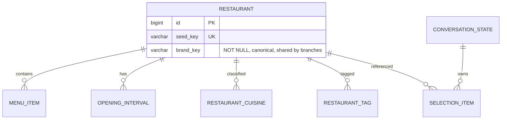

# Данные и PostgreSQL

## Текущий каталог

Flyway **V13**: **36 активных адресных заведений / 23 brandKey /
101 позиция меню / 247 интервалов**. У 32 заведений есть PARTIAL-меню,
у 4 saved menu отсутствует. Пять кухонь: BELARUSIAN, ITALIAN, GEORGIAN,
EUROPEAN, ASIAN; одно заведение может иметь несколько кухонь.
Дата, deployed commit и результаты production upgrade:
[DEPLOYMENT](DEPLOYMENT.md#production-release--2026-10-11).

## Минимальная domain model

| Объект | Основные поля | Обоснование |
|---|---|---|
| Restaurant | id, seedKey, brandKey, name, address, active, catalogSource, catalogVerifiedAt | Конкретное реальное заведение/филиал; правила [brand membership](#post-v2-01--brand-membership) |
| Restaurant check metadata | estimatedCheckPerGuest, checkEstimationType, checkSource, checkVerifiedAt | Независимый ориентир бюджета на одного гостя, BYN; PUBLISHED / DERIVED |
| Restaurant schedule metadata | hoursSource, hoursVerifiedAt | Происхождение собственного недельного расписания |
| Restaurant menu metadata | menuSource, menuVerifiedAt, menuCoverage=PARTIAL | Одно частичное меню без отдельной Menu entity |
| OpeningInterval | restaurantId, weekday, opensAt, closesAt, closesNextDay | Собственное расписание, включая ночь |
| Cuisine / RestaurantTag | Set<Enum> на Restaurant; строки в collection tables | Поисковые признаки, не свободные runtime tags |
| MenuItem | id, restaurantId, seedKey, name, category, dishType optional, priceByn, portion/description/source optional, active | Сохранённая PARTIAL часть, максимум 10 позиций; stable key для import |

Таблица выше описывает существующую модель. Optional website/phone/googlePlaceId
ещё не реализованы. Conversation/selection state описан в разделе
[Разговор и последняя подборка](#разговор-и-последняя-подборка).

Отдельные TelegramUser, UserProfile, Favorite, RecommendationHistory, delivery status/checkpoint entities отсутствуют. Также нет Google rating/review таблиц, MenuVersion и универсального datasource registry.

## POST-V2-01 — brand membership

`Restaurant` остаётся конкретным заведением. V12 добавляет обязательный внутренний
`brand_key VARCHAR(100) NOT NULL` с CHECK canonical format. Default, уникального
ограничения на brand_key, отдельной Brand entity и FK нет: один ключ разделяют филиалы.
Ключ — явный стабильный lowercase ASCII slug `[a-z0-9]+(-[a-z0-9]+)*`, максимум 100
символов. Пустое/null/неканоническое значение отклоняется Java и SQL constraints.
Один ключ разделяют филиалы бренда; самостоятельное заведение получает собственный.
Название, адрес, домен и владелец не определяют принадлежность автоматически.

V12 содержит точный reviewed mapping по всем 30 `seed_key`, включая неактивные
записи, на 17 брендов. Изменяется только новая колонка; исходные ID и все прежние
значения сохраняются. Неизвестная запись без mapping останавливает миграцию на
NOT NULL, вместо назначения неподтверждённого бренда. V1–V11 и immutable JSON
datasets не переписываются. Источник mapping — собственный reviewed каталог.

Новые `Restaurant` создаются с обязательным `brandKey` в конструкторе. Controlled
import использует `CuratedCatalogImport.apply(connection, dataset, brandKeysBySeedKey)`:
явный mapping должен точно покрывать batch, все ключи проверяются до первой записи.
Новый филиал получает существующий ключ после ручной проверки; новый бренд — новый
ключ. SQL не может обнаружить смысловую ошибку куратора, например два разных ключа
одного реального бренда; это проверяется review данных.

Двухаргументный `apply(connection, dataset)` сохранён только для исторической V11,
которая выполняется до появления колонки. Он не выводит brandKey из старых данных;
после V12 попытка добавить им новое заведение блокируется NOT NULL.
Новый overload не меняет V11 input/checksum и не добавляет публичный write endpoint.

Поиск использует ключ только внутри Java service; наружу в catalog/search/Mini App
DTO и AI tool schema он не передаётся. Правило выдачи принадлежит
[ARCHITECTURE](ARCHITECTURE.md#deterministic-ranking).

Проверки миграции и сохранности данных: [POST-V2-01 acceptance](archive/POST-V2-01-ACCEPTANCE.md).

## Данные и их происхождение

### Каталог

Актуальный состав — в [текущем каталоге](#текущий-каталог). История первоначального MVP:
сначала 3 для проверки источников, затем 10 филиалов. Источник — сайт заведения
или пригодный независимый источник, не LLM и не массовый Google import.

Для каждой записи указать конкретный филиал, адрес, source и дату реальной проверки. seedKey — стабильный внутренний ключ для controlled seed/import, name не unique. Tags не проставлять по выдумке модели; куратор фиксирует их по источнику/описанию и обозначает субъективность.

Все monetary values — BYN/BigDecimal, даты/время проверок — явные. verifiedAt означает выполненную проверку источника, не автоматический timestamp импорта.

Restaurant.id — Long / BIGINT GENERATED BY DEFAULT AS IDENTITY. Cuisine и RestaurantTag
— строковые enum collections; OpeningInterval — embeddable collection с weekday,
opensAt, closesAt, closesNextDay. Catalog/details читают собственные DTO через
RestaurantService; menu metadata хранятся на Restaurant. Cuisine filter выполняется
в RestaurantSearchService, не в catalog GET. Entities и seedKey наружу не передаются.
REST contracts принадлежат [ARCHITECTURE](ARCHITECTURE.md#rest-api).

### Estimated-check strategy

estimatedCheckPerGuest означает **ориентировочную сумму на одного гостя** в согласованном сценарии обычного посещения. Это собственное curated значение; не цена конкретной корзины и не статистически подтверждённый средний чек. SQL поле — estimated_check_per_guest NUMERIC(10,2).

Предпочтительный источник — опубликованный ориентир заведения. Если публикуется диапазон, куратор выбирает и объясняет одно консервативное значение. Поле checkEstimationType явно различает **PUBLISHED** и **DERIVED**. Для DERIVED использовать реальные опубликованные цены и прозрачную ручную методику; сохранить состав расчёта, канал цен, source URL и дату проверки в checkSource. Это provenance curated значения, не новый runtime estimator/обязательная entity. Состав конкретного расчёта не является общей формулой приложения. Источники начальных значений приведены ниже.

Для первых трёх DERIVED checks принят единый food-only сценарий: одна выбранная полноценная порция основного блюда + одна порция супа на гостя, без напитков, алкоголя, десерта, доставки и чаевых. Эти две категории доступны во всех трёх кухнях; одинаковый состав делает учебную оценку понятной и воспроизводимой. Это конкретный curated ориентир, не минимум, медиана, статистический или официальный средний чек. Официальный PUBLISHED показатель на проверенных страницах не найден. Java получает готовый BigDecimal; расчёт по меню в runtime отсутствует.

Первоначальный seed проверен 2026-10-02:

| Филиал | Cuisine | Чек на гостя | Источник / ограничение |
|---|---|---|---|
| Васильки — Минск, проспект Независимости, 16 | BELARUSIAN | 39.80 BYN, DERIVED | [Драники с мачанкой по-белорусски](https://vasilki.by/img/menu/Драники_1.jpg) 22.90 + [щи с лесными грибами](https://vasilki.by/img/menu/Супы_1.jpg) 16.90 |
| Pizza Tempo — Минск, ул. Карла Маркса, 26 | ITALIAN | 32.70 BYN, DERIVED | [Паста Карбонара](https://tempo.by/img/menu/пасты%201.jpg) 19.50 + [суп-крем из шампиньонов с сыром с голубой плесенью](https://tempo.by/img/menu/супы%201.jpg) 13.20 |
| Хинкальня — Минск, проспект Дзержинского, 104 | GEORGIAN | 44.00 BYN, DERIVED | [Меню филиала](https://www.titanminsk.by/kafe-i-restoranyi/restoran/menyu/): шашлык из свинины 25.00 + харчо 19.00; без напитков, алкоголя, доставки и чаевых |

Branch applicability для двух сетевых чеков подтверждена на уровне официального общего меню: [Васильки](https://vasilki.by/) и [Pizza Tempo](https://tempo.by/) публикуют один набор страниц основного меню без выбора филиала или отдельных цен филиалов; оба адреса находятся в каталоге соответствующей сети. Выбор категории меню не зависит от выбранного адреса. Отдельного меню филиала сайт не публикует; это сетевой источник, а не индивидуальное подтверждение со стороны персонала. Исключение акции Minsk Card у Васильков на Независимости, 16 относится к скидке; в оценке скидки не учтены. Delivery menus не использованы. Хинкальня использует меню конкретного филиала. Все четыре check-поля заполнены у всех трёх записей; checkVerifiedAt=2026-10-02.

Catalog/hours source и дата сохранены для всех трёх филиалов. Васильки: Вс–Чт 08:00–23:00, Пт–Сб 08:00–01:00 следующего дня; Pizza Tempo: ежедневно 10:00–23:00; Хинкальня: ежедневно 12:00–00:00 следующего дня. COZY/FRIENDS проставлены только Хинкальне по [описанию филиала](https://www.titanminsk.by/kafe-i-restoranyi/restoran/); это curated tags. У остальных tags пусты.

Исторический V9 MVP-каталог: **10 активных конкретных филиалов**, три кухни, по шесть
позиций меню (60 всего). Семь новых филиалов проверены 2026-10-06 по официальным
спискам адресов/часов [Васильки](https://vasilki.by/#container-places) и
[Pizza Tempo](https://tempo.by/#container-places); страницы общего меню выше
визуально проверены повторно в тот же день. Цены и порции совпадают с исходным
dataset. Новым филиалам не присвоены неподтверждённые tags.

| Fresh DB ID / seedKey | Конкретный филиал | Недельные часы | DERIVED BYN на гостя |
|---|---|---|---|
| 4 / pizza-tempo-bobruyskaya-6 | Pizza Tempo — Минск, ул. Бобруйская, 6, ТРЦ «Galileo» | Ежедневно 10:00–00:00 следующего дня | 32.70 |
| 5 / pizza-tempo-nezavisimosti-18 | Pizza Tempo — Минск, проспект Независимости, 18 | Вс–Чт 09:00–23:00; Пт–Сб 09:00–00:00 следующего дня | 32.70 |
| 6 / pizza-tempo-nezavisimosti-78 | Pizza Tempo — Минск, проспект Независимости, 78 | Ежедневно 10:00–23:00 | 32.70 |
| 7 / pizza-tempo-pobediteley-84 | Pizza Tempo — Минск, проспект Победителей, 84, ТРЦ «ARENAcity» | Ежедневно 10:00–22:00 | 32.70 |
| 8 / vasilki-nezavisimosti-58 | Васильки — Минск, проспект Независимости, 58 | Вс–Чт 08:00–23:00; Пт–Сб 08:00–00:00 следующего дня | 39.80 |
| 9 / vasilki-nezavisimosti-89 | Васильки — Минск, проспект Независимости, 89 | Ежедневно 08:00–23:00 | 39.80 |
| 10 / vasilki-yakuba-kolasa-37 | Васильки — Минск, ул. Якуба Коласа, 37, МЦ «Айсберг» | Вс–Чт 11:00–23:00; Пт–Сб 11:00–02:00 следующего дня | 39.80 |

Каждый новый филиал имеет свои catalog/hours/check source и verifiedAt=2026-10-06.
Методика DERIVED сохранена: одна указанная порция основного блюда + одна порция
супа, цены зала без напитков, алкоголя, десерта, доставки и чаевых. Для новых
Васильков это 22.90+16.90, для новых Pizza Tempo — 19.50+13.20 BYN. Состав и URLs
сохранены в checkSource каждого филиала. Общее меню сети применено по той же
границе подтверждения, что у исходных записей; отдельные цены филиалов на сайте
не опубликованы. Чеки одинаковых сетевых филиалов сознательно одинаковы.
Имена повторяются; address/seedKey/ID различают филиалы. Название сети без
достаточного контекста требует уточнения. Initial records/metadata сохраняют
первоначальную дату 2026-10-02; новый timestamp импорта не подменяет verification.
Указанные IDs относятся к fresh DB. При forward upgrade identity sequence может
иметь пропуски; новые IDs тогда отличаются. Seed/import/acceptance используют
stable seedKey и фактически показанные IDs, без предположения о next identity value.

Search использует сохранённый независимый BigDecimal check, без runtime menu basket
или зависимости от MenuItem. Формула бюджета и ranking принадлежат
[ARCHITECTURE](ARCHITECTURE.md#правила-поиска-и-рекомендаций).

Чек должен иметь source и checkVerifiedAt. Если проверить его не удалось — оставить неизвестным, а не 0; такой ресторан не подтверждает budget filter. Проверять источники перед demo; автоматический TTL для menu/check не нужен в MVP. Старые даты остаются видимыми, актуальность не гарантируется датой импорта.

Пользовательская подпись: «Ориентировочный чек, не гарантия итоговой суммы». Не сравнивать несопоставимые источники как доказательство цены любого заказа.

### Menu data strategy

В первоначальном MVP — 5–10 полезных позиций на заведение; V2 допускает несколько
проверенных позиций или отсутствие сохранённого меню. Coverage сохранённого набора
всегда PARTIAL, максимум 10 позиций. Источник и дата относятся к сохранённой части
меню. Полное меню, автоматический scraping и внешний API меню не нужны.

Хранить фиксированные опубликованные BYN-цены. Не выдавать цену «за 100 г» как цену целого блюда; такие позиции лучше не включать в учебный набор. portion optional хранится только если указан в источнике.

dishType — маленький фиксированный enum для доказуемых запросов; сейчас только PASTA. Категории приложения: MAIN, SOUP, PASTA. Имена и цены подтверждены источником; категории вручную сопоставлены разделам основного меню. Ingredients/allergens/availability не выводятся LLM.

Если menu нет или оно неполное, search продолжает пользоваться estimated check. При отрицательном menu query формулировка: «В сохранённой части меню такое блюдо не найдено». Это не доказательство отсутствия блюда вообще.

Menu metadata хранятся один раз на Restaurant: menuCoverage=PARTIAL, menuSource, menuVerifiedAt. Поля либо полностью заполнены, либо все NULL (меню ещё не проверено). MenuItem имеет обязательную ManyToOne/FK restaurant_id → restaurants.id, без обратной коллекции на Restaurant: каталог не загружает блюда. Цена — BigDecimal / NUMERIC(10,2), строго >0; валюта фиксирована BYN в DTO и import contract, отдельная currency column не нужна. verification date общая для сохранённого набора. Optional item source указывает точную страницу, иначе используется menuSource; description/portion nullable, descriptions в начальном dataset отсутствуют. active — признак записи собственного каталога, не гарантия наличия блюда в ресторане.

Начальный dataset проверен 2026-10-02, по 6 позиций на каждый существующий филиал:

| Филиал | Категории | Источники позиций |
|---|---|---|
| Васильки — Независимости, 16 | MAIN, SOUP | [Драники](https://vasilki.by/img/menu/Драники_1.jpg), [супы 1](https://vasilki.by/img/menu/Супы_1.jpg), [супы 2](https://vasilki.by/img/menu/Супы_2.jpg) |
| Pizza Tempo — Карла Маркса, 26 | PASTA, SOUP | [Пасты](https://tempo.by/img/menu/пасты%201.jpg), [супы](https://tempo.by/img/menu/супы%201.jpg) |
| Хинкальня — Дзержинского, 104 | MAIN, SOUP | [Меню конкретного филиала](https://www.titanminsk.by/kafe-i-restoranyi/restoran/menyu/) |

Для двух сетей используется единое официальное основное меню, без отдельного выбора цен по филиалам; граница подтверждения описана в [estimated-check strategy](#estimated-check-strategy). Порции сохранены из этих же страниц; поштучные/за 100 г цены не использованы.

MenuService отдаёт только DTO и active items в порядке id ASC, максимум 10. Фильтры: optional dishType и inclusive maxItemPriceByn (положительный NUMERIC(10,2)); это цена одной позиции, не budget search. Известный ресторан без metadata или active items → DATA_UNAVAILABLE; фильтр без совпадений → NO_RESULTS с сообщением «Не найдено в сохранённой части меню». PARTIAL/source/date сохраняются в response даже при пустом результате, если metadata есть. Незнакомый restaurant id → отсутствие результата сервиса. REST mapping принадлежит [ARCHITECTURE.md](ARCHITECTURE.md#rest-api).

### Controlled seed/import

Базовые три записи поставляются отдельной Flyway data migration V2 после schema V1. Это неизменяемый первоначальный dataset: чистая БД получает одинаковые записи, повторный старт не повторяет INSERT. Последующие изменения данных оформляются новой migration или controlled import; применённый V2 не переписывается. Приложение не вызывает внешние API при seed и не использует startup runner.

Menu seed/import использует один JSON формат: [начальный dataset](../src/main/resources/db/seed/partial-menu-v4.json). Flyway V4 Java migration читает его локально через JDBC, без Spring services, HTTP и startup runner; V3 создаёт schema. V4 хранит checksum JSON, начальный dataset после применения не редактируется. Новые проверки/цены передаются отдельным JSON через MenuImportService.importJson(InputStream) при явном controlled import; публичного write endpoint нет.

Формат: корень menus; у каждой записи restaurantSeedKey, coverage=PARTIAL, source (HTTPS URL), verifiedAt (ISO date), items. У item: seedKey, name, category, optional dishType, priceByn (BYN), optional portion/description/source, обязательный active. Один restaurant/item key не повторяется внутри dataset. Неизвестные JSON поля/types, отсутствующие metadata, неверные цены/URL/размеры полей и >10 items отклоняются. Набор может быть пустым: это недоступные сохранённые данные, а не отсутствие реального меню.

Import заменяет сохранённую часть только перечисленных существующих ресторанов, найденных по seedKey; restaurants не создаются и их identity/check/hours не меняются. Existing items обновляются по (restaurant_id, seed_key) с сохранением id; новые добавляются; пропущенные в переданном наборе удаляются. Название не является ключом: одинаковые названия и разные порции разрешены. Вся загрузка транзакционна, включая metadata; ошибка неизвестного ресторана после записи первого откатывает всё. Строки Restaurant блокируются на время import. Остальные рестораны не меняются.

- Без удалённого URL fetching/scraping.
- Проверить поля, цены, enum values и links до обновления.
- Повторный импорт не создаёт дубли.
- Невалидный dataset не оставляет частично обновлённый каталог.
- Restaurant и menu обновляются по заранее понятным stable keys.
- Регулярно меняющиеся цены/источники не зашиваются в уже применённые schema migrations.

Начальные restaurant SQL и menu JSON datasets входят в application resources. Повторные Flyway migrate и JSON import не создают дубли.

Fresh DB получает итоговые данные автоматически: V2/V4 дают первые 3 филиала
и 18 позиций; [V8](../src/main/resources/db/migration/V8__expand_final_catalog.sql)
добавляет 7 филиалов/49 интервалов, затем V9 Java migration применяет
[partial-menu-v9.json](../src/main/resources/db/seed/partial-menu-v9.json) — 42 позиции.
V9 использует существующий strict MenuDataset contract и JDBC внутри Flyway,
хранит нормализованный checksum JSON; HTTP и startup runner отсутствуют.
Исходные V1–V7 и partial-menu-v4.json неизменны. V8 задаёт порядок новых IDs через
seedKey ASC для одинакового результата на H2/PostgreSQL. Меню всех филиалов PARTIAL.
Повторный controlled import нового JSON через существующий MenuImportService
сохраняет item IDs/keys/counts и не изменяет остальные филиалы.

Далее V10/V11 дают исторический V2 каталог, V12 назначает явные brandKey,
V13 добавляет шесть заведений. Текущий fresh V1→V13 результат — 36/23/101/247;
применённые V11/V13 используют add-only curated import, а не замену старых меню.

## Разговор и последняя подборка

ConversationState/JDBC memory/SelectionItem — **IMPLEMENTED**.

### ConversationState

| Поле | Значение |
|---|---|
| chatId | BIGINT, PK; Telegram private chat, авторитетный scope |
| generation | Неотрицательный счётчик reset, часть derived conversationId |
| currentCriteria | Компактная структура normalized guests/budget/date/time/cuisine/tags |
| selectionVersion | Неотрицательный счётчик delivered search results; первоначально 0 |
| updatedAt | Время последнего изменения; troubleshooting, будущий cleanup |

Одна строка conversation_state на чат; нет истории generations. conversationId
вычисляется из chatId/generation, отдельного column нет. current_criteria — compact
typed JSON в VARCHAR(4000), явно сериализованный SearchRequest: guests Integer,
budget BigDecimal, normalized ISO date/HH:mm strings, optional cuisine/tags enums.
Это state разговора и не участвует в SQL restaurant filtering. JDBC ConversationStore
использует существующий transaction manager; model/Telegram calls вне transactions.

Нет expiresAt, expectedFields, workflow status, delivery status, userId и наборов snapshot. Missing fields вычисляются по criteria. updatedAt не означает обязательный scheduled TTL.

### SelectionItem

**IMPLEMENTED:** JDBC SelectionItemRepository и SelectionService; Flyway
`V7__create_selection_items.sql`. SelectionItem — immutable Java record, без JPA
entity/snapshot. Таблица `selection_items` содержит ровно четыре NOT NULL поля:
chat_id BIGINT, position INTEGER, selection_version BIGINT, restaurant_id BIGINT.

chatId обязателен в дополнение к предложенным selectionVersion/position/restaurantId: version и position не уникальны между чатами. Он служит FK на ConversationState и предотвращает смешение selection разных пользователей.

Хранится максимум 3 строки на чат. PK: (chat_id, position); selection_version копирует текущую ConversationState.selectionVersion. При новой успешной выдаче в одной короткой DB transaction увеличить version, удалить прежние строки, вставить реально показанные ID. История отсутствует; согласованность version обеспечивается этой транзакцией.

Только position и restaurantId: не копировать check/cuisine/tags и Google в snapshot. Детали перечитываются из каталога. Lifecycle и sendMessage описаны только в [AI.md](AI.md#conversationstate-и-selection-context).

## ER

Существующие отношения — IMPLEMENTED:



Spring AI memory связана логически по derived conversationId; framework schema
не получает искусственную FK/duplicating entity. Lifecycle принадлежит [AI](AI.md).

## Constraints

- Restaurant.seedKey unique/not null; name не unique.
- Restaurant.brandKey not null, VARCHAR(100), canonical lowercase ASCII slug с CHECK;
  не unique, принадлежность филиалов задана явно; отдельной Brand table нет.
- estimatedCheckPerGuest nullable либо >0; amount/type/source/verifiedAt либо все NULL, либо полностью заполнены; type только PUBLISHED / DERIVED.
- MenuItem.priceByn >0; валютный смысл фиксирован BYN в контракте.
- MenuItem.seedKey not null; unique (restaurant_id, seed_key) для controlled import, name не unique. Category MAIN/SOUP/PASTA; optional dishType только PASTA для категории PASTA; active not null.
- Для сохранённых menu items import/service требуют menuSource, menuVerifiedAt, PARTIAL metadata.
- OpeningInterval.weekday в диапазоне enum; открытие/закрытие валидируются, overnight явно указан.
- Enum values хранятся строками, не ordinal; unique (restaurant_id, enum_value) в collection tables.
- FK MenuItem/OpeningInterval/enum collections → Restaurant.

ConversationState.chatId PK, generation/selectionVersion ≥0 — IMPLEMENTED.
SelectionItem — IMPLEMENTED: PK (chat_id, position), CHECK position BETWEEN 1 AND 3,
CHECK selection_version >0; FK chat_id → conversation_state.chat_id и
restaurant_id → restaurants.id. В таблице максимум три позиции на chatId; согласованность
version всех rows со state обеспечивается transaction замены, без history/FK на version.
FK без cascading delete. Restaurant будет деактивироваться, а не
физически удаляться при наличии selection references.
Google mapping/columns отсутствуют в текущем MVP.

Constraints не доказывают актуальность источника и существование места; это проверяется куратором и dataset validation.

## Индексы и types

- FK access indexes: MenuItem покрывается unique (restaurant_id, seed_key);
  OpeningInterval — PK (restaurant_id, weekday, opens_at).
- Collection tables покрываются составными PK (restaurant_id, enum_value).
- ConversationState по chatId — PK; JDBC memory index (conversation_id, timestamp) из официальной схемы.
- SelectionItem по chatId/position — составной PK; `idx_selection_restaurant` по restaurant_id.
- Нет expiresAt index, history index и отдельного ranking tuning для небольшого каталога.
- BIGINT/Long для Telegram IDs, NUMERIC/BigDecimal для BYN.
- Не сохранять JPA entities в tool/API responses.

## Flyway

Все versioned migrations V1–V13 реализованы и применены в production:

| Migration | Scope | Состояние |
|---|---|---|
| V1 create restaurant catalog | restaurants, restaurant_cuisines, restaurant_tags, opening_intervals; catalog/check/hours metadata | IMPLEMENTED |
| V2 seed first three restaurants | Первоначальные 3 филиала; 21 недельный интервал | IMPLEMENTED |
| V3 create partial menu | menu_items; menuSource/menuVerifiedAt/menuCoverage на restaurants | IMPLEMENTED |
| V4 seed partial menu (Java) | Локальный immutable JSON: 18 items для существующих 3 ресторанов | IMPLEMENTED |
| V5 create conversation state | chat_id, generation, current_criteria JSON text, selection_version, updated_at | IMPLEMENTED |
| V6 create JDBC chat memory | Spring AI 1.1.8 official PostgreSQL/H2 DDL + conversation ID length adaptation | IMPLEMENTED |
| V7 create selection items | Четыре pointer/context поля; PK, два FK, position/version checks, restaurant index | IMPLEMENTED |
| V8 expand final catalog | Семь проверенных конкретных филиалов и 49 недельных интервалов | IMPLEMENTED |
| V9 seed final partial menus (Java) | Immutable JSON, 42 menu items для новых семи филиалов; existing MenuDataset contract/checksum | IMPLEMENTED |
| V10 extend curated cuisines | EUROPEAN / ASIAN в SQL constraint | APPLIED |
| V11 expand curated catalog (Java) | Immutable reviewed JSON: +20 venues, +29 menu items, +135 intervals; strict add-only import/checksum | APPLIED |
| V12 add restaurant brand key | Обязательный явный ключ, exact mapping 30 заведений → 17 брендов | APPLIED |
| V13 expand verified catalog (Java) | Immutable reviewed JSON: +6 venues, +12 PARTIAL menu items, +42 intervals; explicit brand mapping/checksum, add-only transaction | APPLIED |

Polling checkpoint storage допускается только при подтверждённой необходимости,
если библиотека Telegram не покрывает offset. Отдельная domain subsystem не нужна.

Hibernate ddl-auto=validate. Все изменения схемы — через Flyway; применённые versioned
migrations не переписываются. JDBC memory использует официальную PostgreSQL
схему Spring AI 1.1.8; её framework initialization должно быть отключено через
`spring.ai.chat.memory.repository.jdbc.initialize-schema=never`.
Flyway locations: common `db/migration` плюс `db/memory/{vendor}`. V6 использует точные
DDL resources dependency 1.1.8 для PostgreSQL и H2 без compatibility mode. Затем
conversation_id расширяется с VARCHAR(36) до VARCHAR(64): server ID с signed Long
chatId и Long generation может быть длиннее 36. Остальные framework columns/index/
type checks сохранены. Memory tables не моделируются JPA entities и не имеют FK на state.
Java search не требует дополнительной таблицы.

## PostgreSQL acceptance

V13 acceptance **2026-10-11**: fresh V1→V13 и upgrade V12→V13,
Hibernate/Flyway validate, reapply=0, сохранность старых строк/IDs и synthetic
conversation data, полный rollback при SQL failure — PASS. Targeted PostgreSQL
catalog expansion/migration/audit/shared transport suite: **12 tests PASS**.
135 запросов выполнены дважды, 270 Java search calls: hard filters, deterministic
ranking, лучший филиал бренда и размер `min(3, eligibleBrands)` подтверждены.
Полные H2 `clean test`/`clean verify`: по **575 tests PASS**. Эти числа относятся
к разным наборам и не суммируются. [Историческая локальная acceptance](archive/POST-V2-02C-ACCEPTANCE.md).
Production upgrade V11→V13, сохранность и isolated restore/rehearsal подтверждены
отдельно: [DEPLOYMENT](DEPLOYMENT.md#production-release--2026-10-11).

H2 test profile использует те же migrations и Hibernate validate без compatibility
mode. H2 не доказывает PostgreSQL SQL/constraints или JDBC memory compatibility.
Текущие PostgreSQL checks:

- Flyway на пустой БД и повторный старт.
- Реальный seed/import, estimated check и search.
- Decimal check, strict cuisine, budget boundary, day/overnight и stable ranking.
- Search остаётся тем же после удаления всех MenuItem rows и menu metadata.

Conversation checks: два независимых chatId, typed partial state, 20-message eviction,
safe manual writes, `/new` и application restart. ConversationRestartTest закрывает
полный Spring context/datasource, затем создаёт новые против той же БД; проверяет
generation/currentCriteria/memory и follow-up после восстановления. Физический restart
PostgreSQL server не требуется для этого application-restart contract.
Selection checks: shown order/version, replace/clear/reset, exact/ambiguous names,
chat isolation, rejected/null/throwing Telegram sends и atomic rollback после первой
вставленной позиции при invalid FK следующей. Application restart восстанавливает
selectionVersion и IDs/order. JDBC selection schema проверяется прямыми inserts и
metadata checks; Hibernate validate продолжает проверять существующие JPA mappings.

Тесты каталога используют тот же Flyway SQL и Hibernate validate на H2 без compatibility mode. Для повторения PostgreSQL проверки нужна отдельная пустая development/test БД. Подключение передаётся извне (не использовать рабочую БД):

```powershell
.\mvnw.cmd test "-Dtest=*Test,!RestaurantBotApplicationTest" `
  "-Dspring.datasource.url=$env:DB_URL" `
  "-Dspring.datasource.username=$env:DB_USER" `
  "-Dspring.datasource.driver-class-name=org.postgresql.Driver" `
  "-Dspring.datasource.hikari.minimum-idle=0" `
  "-Dspring.datasource.hikari.maximum-pool-size=4"
```

Пароль передать через SPRING_DATASOURCE_PASSWORD в environment, без CLI argument.
Тесты проверяют migrations/reapply, mappings, constraints, REST, import/rollback и
Java search; изменения тестовых строк откатываются или восстанавливаются.
Search tests используют фиксированный Clock. **История V9 acceptance:** набор проверен 2026-10-06 на
PostgreSQL 17.10: Flyway V1–V9 на пустой test БД/reapply и Hibernate validate прошли.
Полный PostgreSQL suite: 398 tests, 0 failures/errors/skipped, включая application
context/datasource restart, восстановление criteria/generation/bounded memory/selection и `/new`.
После suite сохраняются 10 активных филиалов, 60 menu items и 70 интервалов;
fixtures, включая REST checks вне transaction, восстанавливают изменённые данные.
Отдельный V7→V9 upgrade + application reopen suite: 7 tests PASS; исходные
IDs не изменяются, новые проверяются по seedKey даже при пропуске identity sequence.
FinalCatalogAcceptanceTest проверяет provenance, воспроизводимый DERIVED состав,
idempotent import с сохранением IDs, полные search/budget/hours/ranking/soft-vs-hard
contracts, реальные неоднозначные названия и chat-scoped references.
H2 clean test/verify: по 399 tests; H2-specific bootstrap test исключён из PostgreSQL suite.
Обычная сборка использует H2: [README](../README.md#tests).

## История расширений каталога

Разделы ниже описывают datasets и проверки соответствующих этапов.
Они не заменяют текущее состояние каталога или production release.

### V2-03 — расширенный curated каталог

История dataset V11; актуальный состав — в [текущем каталоге](#текущий-каталог).

Ручная проверка новых данных: **2026-10-07**. Каталог содержит 30 активных заведений
17 брендов: исходные 10 сохранены, добавлены 20 заведений 14 новых брендов.
Это ограниченный curated subset Минска. `Restaurant` по-прежнему означает конкретное
заведение; отдельные Brand/Chain/Venue entities не нужны.

Новые бренды: Кухмистр, Чумацький Шлях, Берёзка, Друзья, Gan Bei (3 адреса),
Coffee Embassy (3), Літвіны (3), Beans & Leaves, BAR:DOT XX1, Ташкент, Ember,
Млын Руж, Чайка, Мимино. Кухни: BELARUSIAN — 13 заведений, ITALIAN — 5,
GEORGIAN — 2, EUROPEAN — 8, ASIAN — 5; возможны несколько кухонь на заведение.
Две новые широкие категории покрывают европейские кафе и азиатскую/узбекскую кухню.

Immutable [dataset V11](../src/main/resources/db/seed/curated-catalog-v11.json) хранит
конкретные адреса, кухни, недельные часы, отдельные источники/даты и объяснения чеков.
Всего 4 PUBLISHED и 26 DERIVED checks. Coffee Embassy публикует сценарий
«завтрак + кофе до 30/35 BYN», доступный весь день; это не обещание цены любого ужина.
У Мимино выбран верх опубликованного диапазона 30–80 BYN из
[карточки Яндекс Карт](https://yandex.com/maps/org/mimino/147722488839/):
официального среднего чека нет, применимость интернет-магазина к залу не доказана.
Этот единственный secondary check-source явно обозначен в provenance;
адрес, кухня и часы подтверждены [официальным сайтом](https://restaurantmimino.by/o-restorane/).
Остальные 29 чеков опираются на официальные источники. DERIVED сценарии используют
реальные цены зала, food-only метод и BigDecimal; у Літвінаў одна полноценная голенка
с гарниром, прямо исключённая из доставки, у остальных новых DERIVED — два блюда.
Оценка Млын Руж не включает шоу/дополнительные услуги. Сетевое меню Gan Bei применяется
только к перечисленным на официальном сайте филиалам; individual staff confirmation
не заявляется. Кухня/закрытие кухни не подменяют часы самого заведения.

89 позиций меню: 60 исходных + 29 новых. Из 20 новых заведений 16 имеют 1–2 проверенные
PARTIAL позиции, 4 — без сохранённого меню (Coffee Embassy ×3, Мимино).
Всего 26 с PARTIAL / 4 DATA_UNAVAILABLE. Меню не участвует в eligibility поиска.
205 недельных интервалов включают закрытые дни и переход через полночь.

V10 расширяет только SQL cuisine constraint. V11 читает проверенный локальный JSON
через `CuratedCatalogDataset` / `CuratedCatalogImport` в транзакции Flyway;
checksum включает dataset. Весь batch проверяется до записи: обязательные поля,
MANUALLY_VERIFIED, цены, часы, optional menu и дубликаты по нормализованным
name + address, в том числе среди неактивных existing записей. Импорт add-only:
повтор прямого импорта отклоняется; Flyway reapply выполняет 0 миграций.
Даты заданы куратором, не временем импорта. Нет HTTP, Spring bean, REST или AI tool
для импорта; непроверенные внешние candidates автоматически не допускаются. V1–V9 неизменны.

Acceptance 2026-10-07: fresh PostgreSQL 17.10 V1→V11 и Hibernate validate PASS,
170 targeted tests PASS на H2 и PostgreSQL, Flyway reapply 0, normalized duplicates 0.
`mvnw.cmd clean test` и `mvnw.cmd clean verify`: по 482 tests PASS, без skipped.
Это локальная acceptance до соответствующего production release.
Google enrichment исключён из текущего MVP: [границы интеграций](ARCHITECTURE.md#внешние-интеграции).
Search rules: [ARCHITECTURE](ARCHITECTURE.md#правила-поиска-и-рекомендаций).
Разговорное поведение: [AI](AI.md). Scope: [PRODUCT](PRODUCT.md).

### Исторический V2 feature acceptance до release

Снимок локальной acceptance **до V2 release 2026-10-08**: 30 конкретных заведений,
89 menu items, Flyway V1–V11, ConversationState, JDBC ChatMemory и SelectionItem.
Он описывает прежний dataset и не заменяет актуальный [каталог V13](#текущий-каталог).

V2-05 не добавляет и не переписывает migrations/data. Final fresh PostgreSQL
acceptance 2026-10-08: отдельный local cluster/database, пустая public schema →
V1–V11, Hibernate validate PASS; **30 active venues, 17 brands, 89 menu items,
205 intervals, normalized duplicate venues 0**. Flyway validate/reapply PASS.
Mini App natural search не записывает criteria/selection/chat memory.
На момент этой локальной проверки production ещё использовал V9,
10 заведений / 60 menu items. Последующие releases применили V11, затем V12/V13.

### V12 — добавление brandKey

История: базовый V2 выпущен 2026-10-08, commit `1b73be8`, V1–V11,
30 заведений / 17 брендов / 89 menu items / 205 intervals.
POST-V2-01 реализовал V12 отдельно; она применена в production 2026-10-11.

[Отчёт acceptance](archive/POST-V2-01-ACCEPTANCE.md).

### POST-V2-02C — каталог V13

Расширение от POST-V2-01 включено в production release 2026-10-11.
Итоговый состав — в [текущем каталоге](#текущий-каталог).
Исходные 30 записей, их IDs, поля и связанные данные сохраняются.

[V13](../src/main/java/db/migration/V13__expand_verified_catalog.java) использует
существующий `CuratedCatalogImport` и immutable
[curated-catalog-v13.json](../src/main/resources/db/seed/curated-catalog-v13.json).
Mapping seedKey → brandKey задан явно в Java migration; checksum включает JSON с
нормализованными переводами строк и отсортированный mapping. Весь batch проверяется
до первой записи; JDBC записи выполняются в транзакции Flyway. Прямой повтор импорта
отклоняется как duplicate, повторный Flyway migrate выполняет ноль миграций.
V1–V12, прежние datasets, схема сущностей и общий search algorithm не изменены.

| seedKey | brandKey | cuisines | DERIVED BYN/гость |
|---|---|---|---:|
| la-scala-nemiga-36 | la-scala | ITALIAN | 76.00 |
| mziuri-pritytskogo-97b | mziuri | GEORGIAN, EUROPEAN | 41.00 |
| pekaridze-platonova-45 | pekaridze | GEORGIAN | 39.00 |
| sorrento-internatsionalnaya-38 | sorrento | ITALIAN | 65.00 |
| da-claudio-karla-marksa-25 | da-claudio | ITALIAN | 60.00 |
| yangtze-svobody-8 | yangtze | ASIAN | 43.00 |

Все шесть имеют PARTIAL по две позиции и семь интервалов зала; tags пусты.
Сохранён исходный reviewed `verifiedAt=2026-10-08` из утверждённого набора.
Обязательная повторная проверка источников перед созданием V13 выполнена
**2026-10-11**, а не назначена timestamp импорта. Адреса, часы, блюда, цены и
provenance находятся в immutable dataset. Историческая локальная migration/search
acceptance: [POST-V2-02C](archive/POST-V2-02C-ACCEPTANCE.md); subsequent production release
подтверждён в [DEPLOYMENT](DEPLOYMENT.md#production-release--2026-10-11).

Чеки — food-only ориентиры основного прайса зала. Для Янцзы 30+3+10 BYN:
гарнир сохранён в происхождении чека, не выдан за MAIN в меню. La Scala остаётся
76, а Мзиури 41, без снижения ради budget threshold. BYN у Сорренто интерпретирован
из связи PDF «Кухня и бар» с официальной минской страницей; ISO-валюта на PDF
отдельно не расшифрована. Применимость и сумма возможных депозитов неизвестны.
У пяти кандидатов время последнего горячего заказа UNKNOWN; часы зала не гарантируют
горячий заказ в 21:00. У La Scala опубликована кухня до 23:00, отдельного kitchen
calendar/фильтра в модели нет. Неопубликованные порции остаются null.

Migration/search checks: [PostgreSQL acceptance](#postgresql-acceptance);
подробный отчёт: [POST-V2-02C acceptance](archive/POST-V2-02C-ACCEPTANCE.md).
